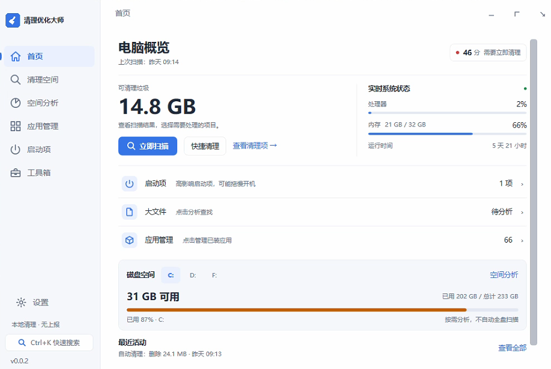
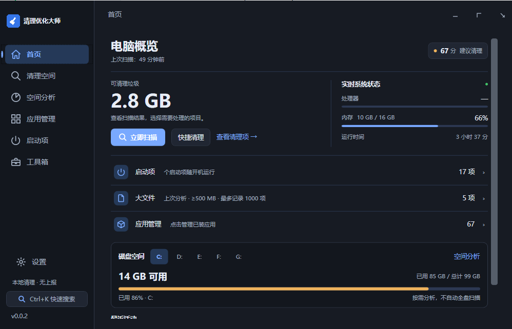
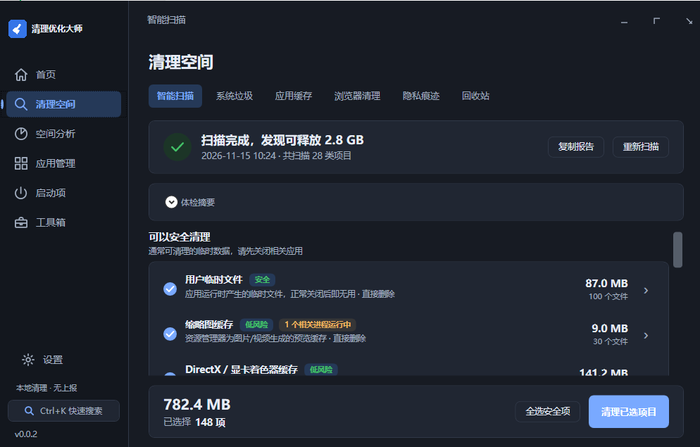
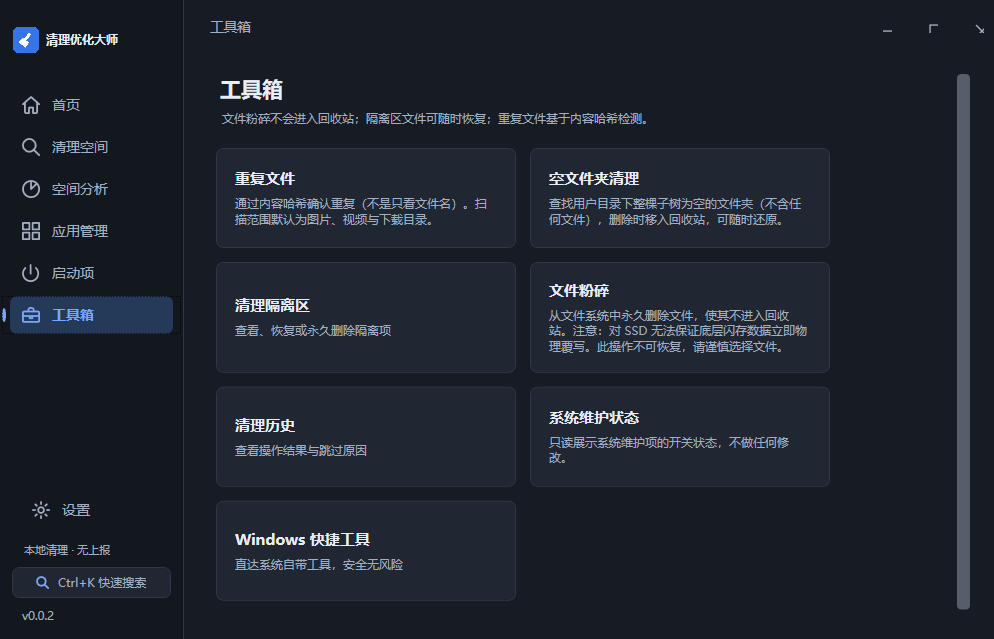

<div align="center">

# 🧹 清理优化大师

**安全、透明、可恢复的 Windows 清理与系统优化工具**

[](../../releases/latest)
[](LICENSE)
[](#-快速开始)
[](#-快速开始)

[简体中文](README.md) | [English](README.en.md) | [繁體中文](README.zh-TW.md) | [日本語](README.ja.md)

**清得明白，优化得安心** —— 可解释、可预览、可恢复，拒绝一切虚假加速。

[⬇️ 下载最新版](../../releases/latest) · [🛠 从源码构建](#-快速开始) · [💬 联系我们](#-联系我们)

</div>

---

## ✨ 界面预览

| 浅色主题 | 深色主题 |
|---|---|
|  |  |

| 全面体检 | 工具箱 |
|---|---|
|  |  |

## ⬇️ 下载

到 [Releases](../../releases/latest) 页面获取（SHA256 校验值见附件 `SHA256SUMS.txt`）：

| 文件 | 适合谁 |
|---|---|
| `CleanOptimizeSetup-x.x.x.exe` | 大多数用户：中文安装向导，支持卸载 |
| `CleanOptimize-x.x.x-win-x64.zip` | 免安装绿色版：解压即用，无需 .NET 运行时（自包含） |

## 🧰 功能总览

| 模块 | 能力 |
|---|---|
| **首页** | 紧凑工作台：健康评分、扫描摘要、CPU / 内存条形监控、磁盘容量条（**多盘切换**）、快捷清理和最近活动；空间分类、近 7 日统计与建议按需展开；隐藏后停止采样 |
| **全面体检** | 扫描 → 体检摘要（评分环 + 三因子条 + 待办直达：高影响启动项 / 维护未开启）→ 清理 → 评分前后对比；一键复制体检报告 |
| **智能扫描** | 一次覆盖系统垃圾 / 浏览器缓存 / 应用缓存 / 回收站；结果按风险分组、逐条可预览文件明细、右键打开位置 / 复制路径 |
| **清理空间** | 系统垃圾（临时文件、崩溃报告、缩略图、着色器缓存、更新缓存等）、应用缓存（微信 / QQ / Discord / Teams / Steam / Epic / VS Code / JetBrains 等 13 类）、浏览器清理（Edge / Chrome / Brave / Opera / Firefox）、隐私痕迹（默认不勾选）、回收站、**自定义清理目录**（用户添加，受安全防护双重校验） |
| **空间分析** | 多线程全盘扫描、分类统计、文件夹占用排行树、大文件查找（大小 + **类型筛选**，打开位置 / 移入回收站 / 白名单） |
| **启动项** | 注册表 Run / 启动文件夹 / 登录计划任务三大来源；启停机制与任务管理器一致；开机耗时展示（官方事件源）；所有变更可恢复 |
| **应用管理** | 卸载表完整枚举、调用应用自带卸载程序、卸载后确定性残留检测（进隔离区可恢复） |
| **工具箱** | 隔离区管理、文件粉碎、重复文件检测（内容哈希，可中途停止）、空文件夹清理、清理历史、系统维护状态（存储感知 / TRIM / 电源计划，只读展示）、DNS 缓存刷新、Windows 官方快捷工具 |
| **效率交互** | `Ctrl+K` 命令面板（页面 / 工具 / 动作全局搜索）、`Ctrl+1..8` 切页、`Esc` 取消扫描、全局右键菜单 |
| **系统集成** | 深色 / 浅色 / 跟随系统主题、8 种界面语言、系统托盘（语言随界面切换）、窗口位置记忆、首次使用引导、自动清理计划、磁盘不足提醒、GitHub 正式版本检查与确认后下载安装；禁用数据上报 |

## 🔒 安全设计（产品核心）

- **统一删除保护**：所有删除必须经 `SafetyGuard` 校验；桌面、文档、图片、下载、System32、WinSxS、Program Files 等在硬编码拒绝表中，任何规则都碰不到
- **风险四级**：安全 / 低风险默认勾选；需确认项（回收站、更新缓存、隐私项）永远不自动选中
- **隔离区可恢复**：非缓存文件先进隔离区（默认保留 30 天），可随时恢复，重名自动处理
- **不跨目录链接**：目录遍历与删除均不跟随 Junction / 符号链接
- **本地清理，无数据上报**：统计和崩溃上报保持关闭；更新功能仅从 GitHub 读取公开正式版本与用户确认的安装包，不上传文件名、路径或内容。清理拒绝 UNC、网络盘和设备路径。
- **可解释**：每一项都说明"为什么可清理、清理后有什么影响、能否恢复、哪个进程正在占用"
- **自动化安全自测**：`CleanOptimize.exe --selftest` 覆盖 15 组安全断言（含空文件夹检测、健康评分分级、自定义目录越界拦截、开机耗时服务等），作为发布门禁集成进 CI

## 🚀 快速开始

环境要求：Windows 10 22H2+ / Windows 11，[.NET 8 SDK](https://dotnet.microsoft.com/download/dotnet/8.0)（零第三方 NuGet 依赖）。

```bash
git clone https://github.com/smftec/cleanoptimize-windows.git
cd cleanoptimize-windows
dotnet build src/CleanOptimize.App/CleanOptimize.App.csproj -c Release
# 运行
src/CleanOptimize.App/bin/Release/net8.0-windows/CleanOptimize.exe
# 安全自测
src/CleanOptimize.App/bin/Release/net8.0-windows/CleanOptimize.exe --selftest
```

推送 `v*` 标签后，GitHub Actions 会自动：构建 → 安全自测 → 发布 → 编译安装包 → 生成校验和 → 创建 Release 草稿。

## 📦 打包发布

```powershell
powershell -NoProfile -ExecutionPolicy Bypass -File scripts\publish.ps1
```

产出：绿色版目录、zip 包、中文安装包（自动检测 [Inno Setup](https://jrsoftware.org/isinfo.php)，安装包脚本见 [scripts/setup.iss](scripts/setup.iss)）、`SHA256SUMS.txt`。默认版本读取项目文件；脚本会运行自包含程序的自测，并逐文件校验 ZIP 的 SHA256。

完整构建与安全回归验证：

```powershell
./scripts/verify.ps1
./scripts/publish.ps1 -RequireInstaller
# 本地工具不在 PATH 时可显式指定：
./scripts/publish.ps1 -DotnetPath C:\tools\dotnet\dotnet.exe -IsccPath C:\tools\Inno\ISCC.exe -RequireInstaller
```

测试使用独立临时数据目录，覆盖隔离区占用失败保留记录、链接边界、重复扫描去重、空目录深度限制、取消与并发历史写入；真实规则只扫描，不执行实际系统清理。日志位于 `dist/verify-Release.log` 与 `dist/selftest.log`。普通推送及 PR 执行验证，标签发布和手动构建复用同一打包脚本。

从零删除编译缓存并执行两种构建、自测与打包：

```powershell
./scripts/full-test.ps1 -DotnetPath .\.tools\dotnet\dotnet.exe -IsccPath .\.tools\inno\ISCC.exe
./scripts/test-packages.ps1
```

`test-packages.ps1` 会解压 ZIP，在新建测试目录安装并自测安装版，随后卸载测试安装；如检测到机器已有同产品安装，会停止以免覆盖。发布程序自测还覆盖全部 8 个页面、8 种语言、两套主题的资源与布局初始化。安全审计与性能基准见 [安全验证记录](docs/VALIDATION-2026-11-13.md)，简洁界面、列表虚拟化与 3.0.2 包验收见 [界面验证记录](docs/UI-VALIDATION-2026-11-13.md)。

3.0.3 修复重复文件在个人目录中无法移入回收站的问题，并补充真实回收与失败统计回归，详见 [重复文件回收修复记录](docs/DUPLICATE-RECYCLE-FIX-2026-11-13.md)。

3.0.4 修复主窗口关闭后进程与托盘残留、再次恢复时抛出异常的问题，详见 [窗口生命周期修复记录](docs/WINDOW-LIFETIME-FIX-2026-11-13.md)。

3.0.5 修复只读隔离项无法清空、空目录重扫格式异常及个人文件粉碎被误拦，并补测带数据的工具页面，详见 [工具箱修复记录](docs/TOOLBOX-FIX-2026-11-13.md)。

3.0.6 调整完整离线安装包的压缩设置，并对安装后全部文件进行 SHA256 比对；无需额外安装运行时，详见 [安装包体积优化记录](docs/PACKAGE-SIZE-2026-11-13.md)。

3.0.7 统一更名为 CleanOptimize，恢复应用图标、简化 logo 和工具切换，并修复自动测试的回收站样本遗留，详见 [更名与界面验收记录](docs/RENAME-UI-VALIDATION-2026-11-13.md)。新版使用 `%LOCALAPPDATA%\CleanOptimize` 数据目录，旧版用户数据保留在原目录。

3.0.8 分开统计永久删除与隔离量，降低大量文件扫描的保留内存，批量写入隔离清单并限制进度刷新频率，详见 [清理性能与完整性报告](docs/CLEANUP-PERFORMANCE-2026-11-13.md)。

3.0.10 恢复首页展示盘，复用现有统计与缓存，隐藏时停止系统采样，并修复运行中卸载不能自动退出的问题，详见 [首页与卸载验收记录](docs/HOME-UNINSTALL-2026-11-13.md)。

3.0.11 按「紧凑工作台」重做首页，明细按需创建，修复关于页微信图片资源路径，详见 [紧凑首页与图片验收记录](docs/COMPACT-HOME-2026-11-14.md)。

3.0.12 移除关于页的仓库地址及对应语言资源，并排展示公众号与微信赞赏图片，支持点击放大扫码，详见 [关于页赞赏图片验收记录](docs/ABOUT-WECHAT-2026-11-14.md)。

3.0.13 启动时检查 `HZ-PRE/cleanwin` 的公开正式 Release（5 分钟缓存，无定时轮询）。发现新版本只显示 Logo 旁红色 `NEW` 和“检查更新”旁的“可更新”，点击标签打开更新框。点击“确认更新”后流式下载安装包并校验 SHA256，再启动安装程序、关闭当前应用；支持取消，下载或启动失败保持应用运行，扫描、清理、卸载期间阻止更新。

3.0.14 清理未调用代码、旧界面样式与过时文案，移除没有实现的每周报告、产品资讯、隐藏文件扫描和目录链接开关；匿名统计、崩溃报告保留并继续禁用。语言回退在生成时合并，运行时仅加载一份完整语言字典，重复选择同一语言不重建。

快捷清理已接入首页、托盘和命令面板：仅扫描默认可选的低风险系统/应用/浏览器缓存，列出结果并确认后清理，支持取消和白名单保护；单项建议只扫描对应规则。完成后释放结果列表、使旧扫描摘要失效，避免额外全盘重扫。自动清理结果通知按设置开关生效，区分实际删除、隔离、跳过和失败：窗口可见时在应用内提示，托盘运行时发送系统通知。退出取消自动清理，正在操作或更新时不启动新的自动清理。

更新读取 `https://api.github.com/repos/HZ-PRE/cleanwin/releases/latest`，Release 必须包含匹配版本的 `CleanOptimizeSetup-{版本}.exe` 和 `SHA256SUMS.txt`。现有 GitHub 工作流生成草稿 Release，需公开发布为正式版本后客户端才能发现；Actions 临时 Artifacts 不作为更新源。SHA256 校验用于验证完整性，自动代码签名仍未启用。

拿到代码签名证书后，加两个环境变量即可输出签名版全套产物：

```powershell
$env:CM_SIGN = "1"; $env:CM_SIGN_SUBJECT = "CN=你的名称"
powershell -File scripts\publish.ps1
```

## 🗺️ Roadmap

- [ ] SignPath Foundation 开源签名（已提交申请路线）
- [ ] 在线清理规则库（签名校验的热更新）
- [x] 开机耗时展示（官方启动性能事件）
- [ ] 深度启动分析（ETW 追踪各阶段耗时）
- [ ] Microsoft Store 分发

## 💬 联系我们

- 🌐 官网：<https://xxxxx.com>
- 📮 邮箱：<dev@xxxxx.com>
- 💚 微信公众号：微信搜一搜「**馋熊冰**」

<div align="center">
  
</div>

## 📄 开源许可

本项目以 **GPL-3.0** 许可证开源（见 [LICENSE](LICENSE)）：可自由使用、修改、分发，衍生作品需同样开源；商业授权 / 闭源定制请联系 <dev@xxxxx.com>。

发布产物中的代码签名由 [SignPath Foundation](https://signpath.org) 面向开源项目免费提供（接入中）。
